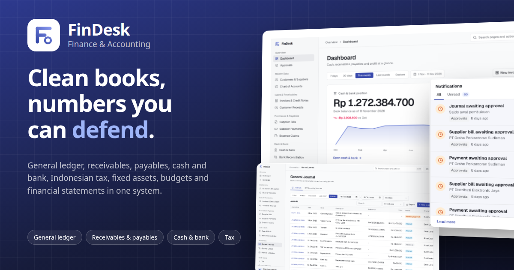

# FinDesk



**Clean books, numbers you can defend.** FinDesk is the finance and accounting module of a small ERP family
(WorkDesk for HR and payroll, StockDesk for inventory, Sopi for sales). It runs the full cycle from a sales invoice
or a supplier bill to the bank, the tax return and the financial statements, with every rupiah traceable to a posted journal.

**Live demo:** [findesk.mujahidin.my.id](https://findesk.mujahidin.my.id)

## The problem it solves

In many growing companies the books live in spreadsheets and an old desktop accounting program: invoices are typed twice,
nobody knows what is still unpaid without calling the bank, VAT is reconciled the night before the deadline, and the
balance sheet only balances after someone "adjusts" it. FinDesk keeps one ledger that every document posts into,
so receivables, payables, cash, tax and the statements always agree with each other.

## Features

**General ledger**

- Chart of accounts with header/postable accounts, control accounts, cost centers and projects
- Manual and opening-balance journals with maker-checker approval, reversals instead of edits, recurring journals
- Every posting goes through one path that checks balance, open period and account rules; posted journals are immutable
- General ledger per account with running balance

**Receivables and payables**

- Sales invoices, credit notes, supplier bills and debit notes on one document model, multi-currency
- PPN 12% with DPP 11/12 (PMK 131/2024), PPh 23 / 4(2) / 21 withheld on bills, PPh withheld by customers on receipts
- Receipts and payments allocated to documents, advances, credit-note application, realized FX gain/loss
- Credit limits (over-limit invoices need approval), aging per customer/supplier, partner statements, printable invoices

**Cash and bank**

- Bank, cash and petty-cash accounts in any currency, cash in/out with VAT, transfers across currencies with fees
- Bank reconciliation: CSV statement import, auto-match, manual match, book bank fees in one click
- Employee expense claims: submit, approve, pay

**Tax, assets and closing**

- VAT output/input report per period, VAT settlement journal, Coretax-friendly export, withholding tax report
- Fixed asset register, straight-line and declining depreciation (fiscal groups per PMK 72/2023), disposal with gain/loss
- Month-end checklist, period close/reopen, FX revaluation with automatic reversal, year-end closing to retained earnings

**Reports and control**

- Balance sheet, income statement (by cost center/project, comparative), cash flow (indirect), trial balance, changes in equity
- Budgets per account and month, budget vs actual
- Approval inbox for everything that needs a second person, audit trail, per-feature access per role

**Around the work**

- **Command palette** (Ctrl/Cmd + K): jump to any page or action, or search partners, accounts, invoices, payments and journals.
- **Due-date calendar** in the header: open receivables and payables by day, one click to the document.
- **Notifications**: live alerts when something waits for your approval or yours was approved, rejected or paid.
- **Dashboard**: cash position with a monthly trend, receivables and payables, revenue vs expenses, expense breakdown, 90-day cash forecast.
- **Account**: profile, language (Indonesian/English), light/dark theme, and a password change confirmed by an emailed code.
- **Export**: reports and lists to Excel, CSV or PDF, and printable documents.

## Roles

| Role | Can do |
| --- | --- |
| Admin | Everything, including reopening periods and closing the year |
| Finance Manager | Approves, closes months, revalues FX, manages budgets |
| Accountant | Journals, depreciation, VAT settlement, reconciliation, approvals |
| Finance Staff | Invoices, bills, receipts, payments, cash, transfers |
| Auditor | Reads everything, changes nothing |
| Employee | Own expense claims only |

## Security

Every rule is enforced in the database with Postgres Row Level Security, triggers and `SECURITY DEFINER` functions, not
only in the UI. Even a request sent straight to the API cannot post into a closed period, edit a posted journal, approve
its own document or read a feature the role has no access to. The client never decides a price, tax, total, balance or
document number; the server computes them. Posted documents are voided by a reversing journal, never edited or deleted.
The UI only hides buttons the database would refuse anyway. SQL smoke tests in `supabase/tests/` check these rules.
Sign-in is protected by Cloudflare Turnstile, and changing a password needs a code sent to the account's email.

## Tech stack

Vue 3, TypeScript, Vite, Tailwind CSS 4, shadcn-vue (reka-ui), TanStack Vue Query, Pinia and vue-i18n on the front end.
Supabase (Postgres, Auth, Storage, Realtime, Edge Functions) on the back end. Deployed on Vercel.

## Running locally

Requires Node 24 and pnpm.

```bash
pnpm install
cp .env.example .env.local        # VITE_SUPABASE_URL, VITE_SUPABASE_PUBLISHABLE_KEY
pnpm dev                          # http://localhost:8080
```

Database: create a Supabase project, put its ref in `supabase/config.toml` and `vercel.json` (`<project-ref>`), then

```bash
supabase link --project-ref <ref>
supabase db push
supabase functions deploy
```

First admin, from the SQL editor: `SELECT public.superadmin_bootstrap('you@example.com', 'StrongPass1');`.
Demo data (ten months of activity through the real posting functions): `SELECT public.seed_demo_data();`
then sign in as `manager@findesk.demo`, `accountant@findesk.demo`, `staff@findesk.demo`, `auditor@findesk.demo`
or `employee@findesk.demo` (password `Demo12345`).

## Checks

```bash
pnpm build && pnpm lint && pnpm test:run
supabase/scratch/run.sh           # every migration + SQL smoke tests on a throwaway Postgres (docker)
```

`GUIDELINE.md` explains the code layout, the conventions and the database rules.

## License

MIT © [Mujahidin](https://mujahidin.my.id). See `LICENSE`.
